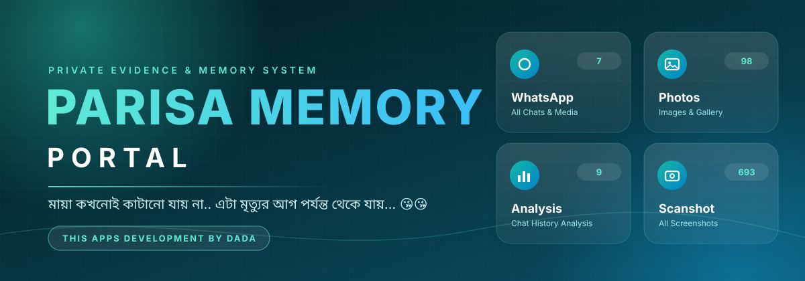

<p align="center">
  
</p>

<h1 align="center">PARISA MEMORY PORTAL</h1>

<p align="center">
  <b>PRIVATE EVIDENCE &amp; MEMORY SYSTEM</b><br/>
  <i>THIS APPS DEVELOPMENT BY DADA</i>
</p>

<p align="center">
  
  
  
</p>

---

## 📌 সংক্ষিপ্ত পরিচয়

PARISA MEMORY PORTAL একটি ব্যক্তিগত মেমোরি ও এভিডেন্স ড্যাশবোর্ড। এখানে হোয়াটসঅ্যাপ, মেসেঞ্জার ও টেলিগ্রামের চ্যাট, ছবি, অডিও, ভিডিও, স্ক্রিনশট এবং ব্যক্তিগত ফাইল এক জায়গায় দেখা ও বিশ্লেষণ করা যায়।

## 🖥 ড্যাশবোর্ড

অ্যাপ খুললে উপরে থাকে মেনু বোতাম, অ্যাপের নাম ও প্রোফাইল ছবি। মাঝখানে প্রোফাইল ছবি ও একটি উদ্ধৃতি দেখা যায়। নিচে নয়টি মডিউল কার্ড থাকে, প্রতিটিতে ফাইল বা রেকর্ডের সংখ্যা লেখা থাকে।

| # | মডিউল | বিবরণ | স্ক্রিনশটে সংখ্যা |
|---|---|---|---|
| 1 | **WhatsApp** | সব চ্যাট ও মিডিয়া | 7 |
| 2 | **Messenger** | মেসেঞ্জার চ্যাট হিস্ট্রি | 3 |
| 3 | **Telegram** | টেলিগ্রাম চ্যাট হিস্ট্রি | 1 |
| 4 | **Photos** | ছবি ও গ্যালারি | 98 |
| 5 | **Audio** | ভয়েস ও অডিও ফাইল | 21 |
| 6 | **Videos** | সব ভিডিও ফাইল | 17 |
| 7 | **Scanshot** | সব স্ক্রিনশট | 693 |
| 8 | **Analysis** | চ্যাট হিস্ট্রি বিশ্লেষণ | 9 |
| 9 | **Personal** | ব্যক্তিগত ভিডিও ও ফাইল | 203 |
| 10 | **BLACK MAGIC PROOF** | ব্ল্যাক ম্যাজিক এর প্রমাণ।| 15 |
| 11 | **CALL LIST** | কল লিস্ট পিডিএফ ফাইল।| 09 | 

নিচের ফুটারে `THIS APPS DEVELOPMENT BY DADA` লেখা থাকে এবং একটি Telegram বোতাম আছে।

## ✨ ফিচার

- **চ্যাট আর্কাইভ:** WhatsApp, Messenger ও Telegram-এর চ্যাট হিস্ট্রি সংরক্ষিত ও দেখা যায়।
- **মিডিয়া গ্যালারি:** ছবি, অডিও ও ভিডিও আলাদা বিভাগে সাজানো।
- **স্ক্রিনশট ইভিডেন্স:** সংরক্ষিত সব স্ক্রিনশট এক জায়গায়।
- **চ্যাট বিশ্লেষণ:** চ্যাট হিস্ট্রি বিশ্লেষণের জন্য আলাদা মডিউল।
- **ব্যক্তিগত ফাইল:** ব্যক্তিগত ভিডিও ও অন্যান্য ফাইল আলাদাভাবে রাখা।
- **প্রোফাইল ও মেনু:** উপরের মেনু ও প্রোফাইল বোতাম দিয়ে নেভিগেশন।

## 🚀 ইনস্টলেশন

```bash
git clone https://github.com/DADA310724/PARISA-MEMORY-PORTAL.git
cd PARISA-MEMORY-PORTAL
```

নির্ভরতা ইনস্টল ও চালু করার কমান্ড রিপোজিটরির কোড অনুযায়ী এখানে যোগ করুন।

## 🔐 নিরাপত্তা নোট

- এটি ব্যক্তিগত ডেটার অ্যাপ। ছবি, চ্যাট ও ব্যক্তিগত ফাইল অন্য কারো সাথে শেয়ার করার আগে সাবধান থাকুন।
- কোনো API কী বা গোপন তথ্য কোডে রাখবেন না; `.env` ফাইল ব্যবহার করুন।
- 
```bash
PARISA MEMORY PORTAL — Required Secrets
Copy this file, fill in your values, then add each one
as a Replit Secret (or environment variable on other hosts).

Firebase Realtime Database
FIREBASE_API_KEY=AIzaSy...
FIREBASE_AUTH_DOMAIN=your-project.firebaseapp.com
FIREBASE_DATABASE_URL=https://your-project-default-rtdb.firebaseio.com
FIREBASE_PROJECT_ID=your-project
FIREBASE_STORAGE_BUCKET=your-project.firebasestorage.app
FIREBASE_MESSAGING_SENDER_ID=123456789
FIREBASE_APP_ID=1:123456789:web:abc123
FIREBASE_MEASUREMENT_ID=G-XXXXXXX

Google Drive
GOOGLE_DRIVE_API_KEY=AIzaSy...
GOOGLE_DRIVE_PARENT_FOLDER_ID=1AbCd...  Root Drive folder ID
GOOGLE_SERVICE_ACCOUNT_JSON={"type":"service_account","project_id":"..."}
GOOGLE_OAUTH_CLIENT_ID=123456.apps.googleusercontent.com
GOOGLE_OAUTH_CLIENT_SECRET=GOCSPX-...

AI Providers (comma-separated if multiple keys)
GROQ_API_KEYS=gsk_...,gsk_...
GEMINI_API_KEYS=AIzaSy...,AIzaSy...
OPENROUTER_API_KEYS=sk-or-...

Telegram Notifications
TELEGRAM_BOT_TOKEN=123456:ABC-...
TELEGRAM_CHAT_ID=-1001234567890
TELEGRAM_CONTACT=https://t.me/your_username

App Config
PROFILE_LOGO_URL=https://i.ibb.co/...  Profile image URL
SESSION_SECRET=any-random-long-string-here
```

## 👤 নির্মাতা
<p align="center">
  
</p>

<h1 align="center">PARISA MEMORY PORTAL</h1>

<p align="center">
  <b>PRIVATE EVIDENCE &amp; MEMORY SYSTEM</b><br/>
  <i>THIS APPS DEVELOPMENT BY DADA</i>
</p>

<p align="center">
  
  
  
</p>

---

<p align="center"><sub>© PARISA MEMORY PORTAL · THIS APPS DEVELOPMENT BY DADA</sub></p>
